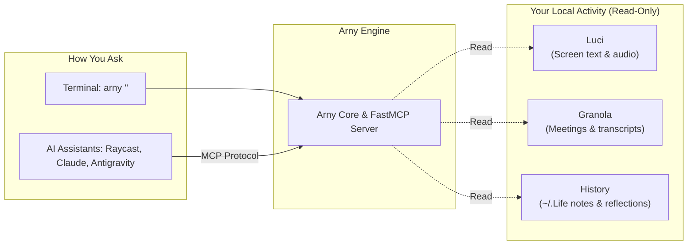

# Arny

**Arny** gives your AI tools and terminal memory of what you did, saw, and discussed.

Instead of copying and pasting screenshots, meeting transcripts, or daily notes into your AI prompt, Arny connects them directly to your assistant.



---

## What Arny Does

1. **Answers in plain language**: Run `arny "what did I discuss with Sarah today?"` in your terminal. It checks your sources and summarizes the answer with citations. If no LLM key is set, it outputs cleanly ranked excerpts.
2. **Plugs into your favorite agents**: Runs a standard [Model Context Protocol (MCP)](https://modelcontextprotocol.io/) server so tools like **Claude Code**, **Raycast AI**, and **Antigravity CLI** can search your history automatically.
3. **Safe & Read-Only**: Arny only reads. It never writes to, moves, or alters your personal files or databases. If a tool isn't installed or running, Arny simply displays a polite warning and keeps going.

---

## Quickstart & Installation

You can run Arny with or without installing it:

### Option A: Install Globally (Recommended)
Fastest startup, clean commands, and best for MCP apps:

```sh
# Install from local checkout (edits take effect immediately)
uv tool install --editable .

# Or install from GitHub
uv tool install git+https://github.com/akulafb/arny.git

# Run directly
arny "what did I work on today?"
```

### Option B: Run Without Installing (`uvx`)
Zero setup, runs in a temporary cache on the fly:

```sh
uvx --from git+https://github.com/akulafb/arny arny "what did I work on today?"
```

---

## Connect to Your AI Apps (MCP)

Arny provides an MCP server over stdio via `arny serve`.

### Raycast AI Chat
1. In Raycast, run **Install Server** (under the MCP extension).
2. Set **Name** to `arny`, **Command** to `uvx`, and **Arguments** to `arny serve`.
3. In Raycast AI Chat, mention `@arny` to query your context.

```json
{
  "mcpServers": {
    "arny": { "command": "uvx", "args": ["arny", "serve"] }
  }
}
```

### Claude Code CLI
Run in your terminal:
```sh
claude mcp add arny --scope user -- uvx arny serve
```

### Antigravity (agy CLI)
Add Arny to `~/.gemini/config/mcp_config.json`:
```json
{
  "mcpServers": {
    "arny": {
      "command": "uvx",
      "args": ["arny", "serve"]
    }
  }
}
```

---

## Configuration

Arny works out of the box with zero configuration by looking for default paths. You can customize behavior using environment variables:

### AI Synthesizer (Optional)
When set, Arny drafts a synthesized summary. Without an API key, Arny simply shows matching excerpts.
- `GEMINI_API_KEY`: Use Google Gemini.
- `ANTHROPIC_API_KEY`: Use Claude.
- `OPENAI_API_KEY`: Use OpenAI.

### Custom Data Paths (Optional)
- `LUCI_PATH`: Custom path to `luci` binary (defaults to `~/.local/bin/luci`).
- `GRANOLA_CLI_PATH`: Custom path to Granola Companion CLI.
- `ARNY_GRANOLA_EXPORT_DIR`: Folder containing exported Granola CSV or Markdown notes.
- `LIFE_PATH`: Custom directory for personal notes (defaults to `~/.Life`).
- `FB_MODE_PATH`: Custom directory for agent runs (defaults to `~/.fb-mode/runs`).

---

## Development & Testing

```sh
# Install dependencies
uv sync

# Run tests (runs 100% offline with mocks)
uv run pytest -q

# Test the CLI locally
uv run arny "test query"
```
